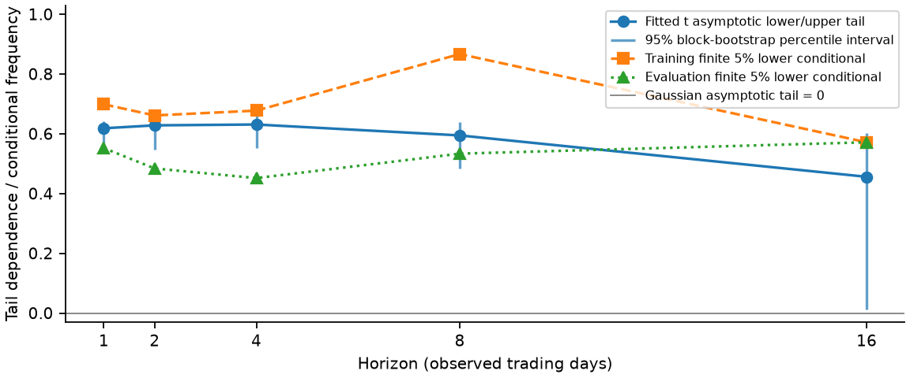
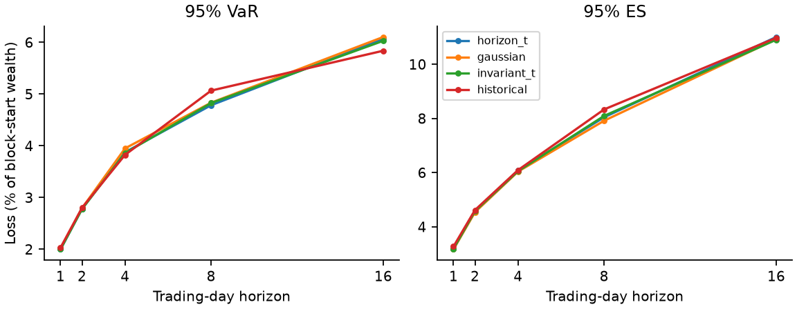
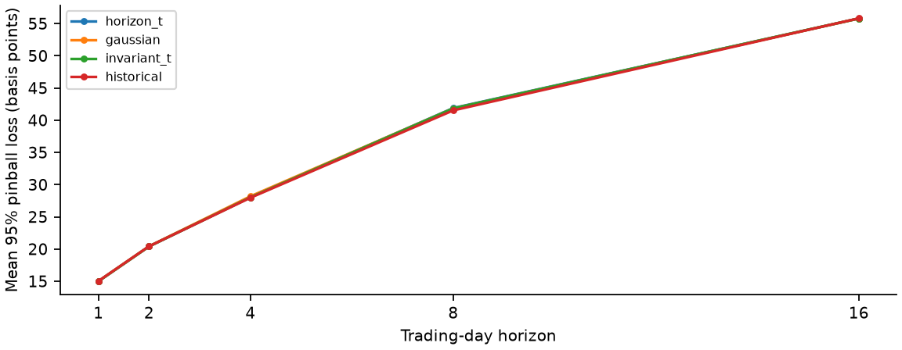

# Risk across tails and Haar horizons: HiTec + Manuf

Evidence draft for human/team review; NOT submission approved. Question: does fitted tail dependence change with horizon, and how much risk changes when dependence is held invariant or Gaussian? A fixed 2006-2015 model is evaluated on untouched 2016-2025 returns. This is a risk-model comparison, not a trading strategy or causal study.

Data: first value-weighted daily section of Kenneth French 5 Industry Portfolios; sectors HiTec and Manuf. Selected coverage 2006-01-03 through 2025-12-31: 5031 observed dates; training 2517, evaluation 2514. Percentage returns are divided by 100. Missing sentinels -99.99/-999, nonfinite/invalid returns, duplicate and unsorted dates are rejected, not imputed.

Audit: 0 missing values, 0 nonfinite values, 0 duplicate dates. There are 186 absent weekdays between observed endpoints; these include exchange holidays and are not established missing trading sessions. No independent exchange-calendar completeness claim is made. Full year counts and extrema dates are in results.json.

| Sector | Minimum daily (%) | Maximum daily (%) | Mean daily (%) |
| --- | --- | --- | --- |
| HiTec | -12.560 | 12.850 | 0.0646 |
| Manuf | -11.730 | 14.400 | 0.0417 |

Choose two broad US sector research portfolios to keep estimation interpretable: technology and manufacturing provide distinct labels but are strongly exposed to common equity shocks. These are research portfolios, not frictionless tradeable ETFs. Source construction assigns NYSE/AMEX/NASDAQ stocks by SIC at June-end; the present archive is revised historical data, not point-in-time vintages. The library documents its 2025 FIZ-to-CIZ format change.

Causal Haar construction: for h = 1,2,4,8,16, x_t = log(1+r_t). On each completed disjoint block, orthonormal Haar coarse coefficient a_h = sum(x_t)/sqrt(h). Recover the actual sector holding-period return R_h = exp(sqrt(h)*a_h)-1. PyWavelets computes the coarsest scaling coefficient within each block. At h=1 the transform is identity. This is a wavelet multiresolution scaling/coarse approximation, NOT a band-pass detail-return study; Haar details describe signed oscillations and cannot be compounded as investable returns.

Portfolio starts every h-day block with 50% wealth in each sector and holds those sector exposures until block-end, then rebalances: R_p,h = (R_HiTec,h + R_Manuf,h)/2; loss L_h = -R_p,h. This is not daily rebalancing inside multi-day blocks. No annualization, square-root-of-time risk scaling, risk-free subtraction, fees or leverage. Split before transformations; align separately at first training and evaluation observation. Incomplete terminal blocks are discarded. No block straddles the split and no full-sample transform/filter is used.

# Dependence estimation and tail uncertainty

Ranks U_ij = rank(R_ij)/(n+1), with average ties, train each horizon independently. Maximize bivariate Student-t copula pseudo-log-likelihood sum(log f_t,2(z1,z2;rho,nu) - log f_t(z1;nu) - log f_t(z2;nu)), z_j=t_nu inverse(U_j), rho bounded [-0.98,0.98], nu grid [2.1, 3, 4, 5, 7, 10, 15, 30, 60]. Gaussian rho is separately fitted by the corresponding normal copula likelihood. Empirical margins stay the same across all simulated copulas. Grid/bounds are numerical/model restrictions, not evidence of a true tail law; boundary fits especially require caution.

Student-t symmetric asymptotic lower/upper tail lambda = 2*t_(nu+1)(-sqrt((nu+1)*(1-rho)/(1+rho))). Gaussian lambda=0 for |rho|<1, but its finite-threshold co-exceedance need not be zero. Finite lower diagnostic is Pr(U_Manuf <= q | U_HiTec <= q), upper analog at 1-q. Each period is ranked independently for diagnostics only; evaluation ranks never set forecasts. Results include q=0.05 and q=0.10 and both tails. Symmetric t cannot represent asymmetric crash/rally dependence.

| h | n train | rho t | nu | lambda t | 95% lambda interval | n effective* |
| --- | --- | --- | --- | --- | --- | --- |
| 1 | 2517 | 0.821 | 2.1 | 0.618 | [0.566, 0.642] | 473.6 |
| 2 | 1258 | 0.830 | 2.1 | 0.628 | [0.547, 0.662] | 339.8 |
| 4 | 629 | 0.833 | 2.1 | 0.631 | [0.552, 0.670] | 362.2 |
| 8 | 314 | 0.797 | 2.1 | 0.594 | [0.485, 0.640] | 227.3 |
| 16 | 157 | 0.809 | 5 | 0.456 | [0.013, 0.603] | 157.0 |

Uncertainty: 199 seeded circular moving-block resamples of paired horizon observations; block length ceil(20/h), approximately one trading month. Refit ranks and t likelihood per training resample, report 2.5/97.5 percentile intervals. Separate evaluation finite-tail resamples never affect forecasts. *Effective n is an initial-positive-autocorrelation heuristic for the lower joint 5% indicator, not a proven count of independent observations. Overlapping intervals alone are not a formal equality test. Horizon estimates are dependent; no formal multiple-horizon significance claim is made.

Point estimates vary with horizon, but this sample does not establish a reliable monotone horizon law. Long-horizon intervals are broad and only a few joint-tail events remain. A single stationary fit blends crisis/non-crisis states; uncertainty conditional on this choice does not cover all regime or grid misspecification.

# Measured holding-period risk and controlled ablation

Simulate 100,000 paired uniforms per copula with seed 20261005+h, then empirical inverse-CDF sector margins (no extrapolation past training extremes). Compute the equal-weight portfolio loss. VaR is the empirical 95% inverse-CDF loss quantile. ES is the integrated worst 5% loss mass, with a fractional order statistic at the boundary to handle ties exactly. Three deterministic independent Monte Carlo seed batches quantify numerical sensitivity; JSON stores their min/max ranges, not statistical confidence intervals.

Models: horizon_t refits both rho and nu per scale; gaussian removes asymptotic tail dependence but has its own fitted correlation; invariant_t reuses DAILY TRAINING t rho and nu at every horizon with that horizon's SAME empirical margins; historical samples the observed training joint portfolio distribution. The invariant_t comparison isolates scale dependence within the t family. Gaussian comparison changes copula family/shape and cannot alone isolate horizon invariance. Models are frozen after training, with no volatility updating.

| h | Model | VaR95 (%) | ES95 (%) |
| --- | --- | --- | --- |
| 1 | horizon_t | 2.0000 | 3.1897 |
| 1 | gaussian | 2.0200 | 3.1678 |
| 1 | invariant_t | 2.0000 | 3.1897 |
| 1 | historical | 2.0300 | 3.2724 |
| 2 | horizon_t | 2.7825 | 4.5917 |
| 2 | gaussian | 2.7955 | 4.5413 |
| 2 | invariant_t | 2.7788 | 4.5809 |
| 2 | historical | 2.8023 | 4.6191 |
| 4 | horizon_t | 3.8770 | 6.0785 |
| 4 | gaussian | 3.9513 | 6.0389 |
| 4 | invariant_t | 3.8620 | 6.0565 |
| 4 | historical | 3.8263 | 6.0937 |
| 8 | horizon_t | 4.7860 | 8.0452 |
| 8 | gaussian | 4.8346 | 7.9174 |
| 8 | invariant_t | 4.8281 | 8.0954 |
| 8 | historical | 5.0682 | 8.3349 |
| 16 | horizon_t | 6.0705 | 11.0094 |
| 16 | gaussian | 6.1047 | 10.9275 |
| 16 | invariant_t | 6.0307 | 10.9086 |
| 16 | historical | 5.8390 | 10.9774 |

| h | t-Gauss VaR (bp) | t-Gauss ES (bp) | t-invariant VaR (bp) | t-invariant ES (bp) |
| --- | --- | --- | --- | --- |
| 1 | -2.00 | 2.19 | 0.00 | 0.00 |
| 2 | -1.30 | 5.04 | 0.37 | 1.08 |
| 4 | -7.44 | 3.95 | 1.50 | 2.20 |
| 8 | -4.86 | 12.78 | -4.21 | -5.01 |
| 16 | -3.43 | 8.19 | 3.98 | 10.08 |

Positive differences mean the horizon-t risk estimate is larger; signs are not presumed. Tail dependence does not imply every 95% quantile rises: dependence shape, high common correlation, and finite empirical margins matter. Small differences can be comparable to Monte Carlo variation or much smaller than estimation uncertainty. Daily t and invariant-t agree exactly by design.

# Actual out-of-sample backtest

Each completed evaluation block contributes one actual portfolio loss; no overlaps within a horizon. Forecasts are constant within each horizon. Breach = observed loss strictly above VaR; target 5%. Exact two-sided binomial p-values and Clopper-Pearson intervals assume independent identically distributed breaches, an assumption not assured by financial time series. Serially dependent data motivate additional moving-block breach-rate intervals in JSON. Multiple models/horizons are descriptive comparisons, not corrected hypothesis tests.

| h | Model | n test | Breaches | Rate (%) | Binomial p* | Pinball (bp) |
| --- | --- | --- | --- | --- | --- | --- |
| 1 | horizon_t | 2514 | 100 | 3.98 | 0.0173 | 14.997 |
| 1 | gaussian | 2514 | 97 | 3.86 | 0.0079 | 15.018 |
| 1 | invariant_t | 2514 | 100 | 3.98 | 0.0173 | 14.997 |
| 1 | historical | 2514 | 95 | 3.78 | 0.0039 | 15.030 |
| 2 | horizon_t | 1257 | 50 | 3.98 | 0.1052 | 20.414 |
| 2 | gaussian | 1257 | 49 | 3.90 | 0.0801 | 20.428 |
| 2 | invariant_t | 1257 | 51 | 4.06 | 0.1363 | 20.411 |
| 2 | historical | 1257 | 48 | 3.82 | 0.0601 | 20.436 |
| 4 | horizon_t | 628 | 20 | 3.18 | 0.0349 | 28.058 |
| 4 | gaussian | 628 | 19 | 3.03 | 0.0216 | 28.195 |
| 4 | invariant_t | 628 | 21 | 3.34 | 0.0546 | 28.032 |
| 4 | historical | 628 | 21 | 3.34 | 0.0546 | 27.973 |
| 8 | horizon_t | 314 | 20 | 6.37 | 0.2445 | 41.889 |
| 8 | gaussian | 314 | 20 | 6.37 | 0.2445 | 41.822 |
| 8 | invariant_t | 314 | 20 | 6.37 | 0.2445 | 41.831 |
| 8 | historical | 314 | 19 | 6.05 | 0.3646 | 41.529 |
| 16 | horizon_t | 157 | 8 | 5.10 | 0.8550 | 55.793 |
| 16 | gaussian | 157 | 8 | 5.10 | 0.8550 | 55.790 |
| 16 | invariant_t | 157 | 8 | 5.10 | 0.8550 | 55.797 |
| 16 | historical | 157 | 8 | 5.10 | 0.8550 | 55.815 |

95% pinball loss = mean(max(0.95*(L-VaR), -0.05*(L-VaR))); lower is better, in loss units. It jointly penalizes breaches and unnecessarily high quantiles; breach rates alone do not rank models. Different horizon losses have different units of holding-period exposure, so do not interpret increasing cross-horizon pinball as declining model quality.

The horizon-specific t model is not uniformly best against historical or invariant-t. Short-horizon fixed forecasts can be overly conservative, while crisis losses still cluster; a nonsignificant coverage test at a sparse horizon is not proof of calibration. No trading-profit, investable-strategy, causal, or universal superiority claim is supported.

# Small tails and ES: diagnostics, not validation

| h | Train lower joint / cond. | Train lower freq [95% CI] | Eval lower joint / cond. | Eval lower freq [95% CI] |
| --- | --- | --- | --- | --- |
| 1 | 88/126 | 0.698 [0.587, 0.752] | 69/125 | 0.552 [0.451, 0.672] |
| 2 | 41/62 | 0.661 [0.500, 0.794] | 30/62 | 0.484 [0.397, 0.645] |
| 4 | 21/31 | 0.677 [0.515, 0.812] | 14/31 | 0.452 [0.290, 0.600] |
| 8 | 13/15 | 0.867 [0.498, 0.933] | 8/15 | 0.533 [0.267, 0.734] |
| 16 | 4/7 | 0.571 [0.142, 1.000] | 4/7 | 0.571 [0.143, 0.858] |

Finite 5% conditional frequencies are not asymptotic lambda estimates. At the longest horizon only a handful of conditioning observations remain, and bootstrap ties may reduce rank counts further. Full upper-tail and 10% diagnostics, effective sample sizes, and incomplete-block counts are retained in results.json.

ES is not validated by the VaR coverage test. Descriptive ES residual = ES - VaR - mean(max(L-VaR,0))/0.05; zero is a calibration moment when VaR and ES are jointly correct (with quantile/tie qualifications). It is not a standalone ES test. Observed mean loss above forecast VaR is also stored, but differs from an unconditional 5%-tail ES when coverage differs. Positive residual means the forecast excess-tail budget is above observed average excess loss, not proven conservatism under future stress.

| h | Model | ES residual (%) | 95% block interval (%) |
| --- | --- | --- | --- |
| 1 | horizon_t | 0.2561 | [-0.407, 0.706] |
| 1 | gaussian | 0.2299 | [-0.430, 0.677] |
| 1 | invariant_t | 0.2561 | [-0.407, 0.706] |
| 1 | historical | 0.3321 | [-0.325, 0.778] |
| 2 | horizon_t | 0.6380 | [-0.110, 1.221] |
| 2 | gaussian | 0.5849 | [-0.161, 1.165] |
| 2 | invariant_t | 0.6280 | [-0.121, 1.212] |
| 2 | historical | 0.6611 | [-0.083, 1.240] |
| 4 | horizon_t | 0.7246 | [-0.496, 1.627] |
| 4 | gaussian | 0.6577 | [-0.550, 1.546] |
| 4 | invariant_t | 0.7078 | [-0.515, 1.615] |
| 4 | historical | 0.7567 | [-0.471, 1.676] |
| 8 | horizon_t | 0.1845 | [-2.388, 2.010] |
| 8 | gaussian | 0.0699 | [-2.487, 1.875] |
| 8 | invariant_t | 0.2461 | [-2.313, 2.053] |
| 8 | historical | 0.5460 | [-1.932, 2.255] |
| 16 | horizon_t | 0.8774 | [-4.860, 4.037] |
| 16 | gaussian | 0.7962 | [-4.934, 3.938] |
| 16 | invariant_t | 0.7758 | [-4.971, 3.956] |
| 16 | historical | 0.8410 | [-4.950, 4.120] |

| h | Pinball t-HS (bp) | Paired 95% block interval (bp) | Pinball t-invariant (bp) | Paired interval (bp) |
| --- | --- | --- | --- | --- |
| 1 | -0.0331 | [-0.064, 0.005] | 0.0000 | [0.000, 0.000] |
| 2 | -0.0216 | [-0.046, 0.007] | 0.0037 | [-0.001, 0.008] |
| 4 | 0.0848 | [-0.003, 0.165] | 0.0257 | [0.001, 0.050] |
| 8 | 0.3595 | [-0.243, 1.241] | 0.0577 | [-0.036, 0.192] |
| 16 | -0.0221 | [-0.907, 0.715] | -0.0038 | [-0.156, 0.123] |

Paired bootstrap intervals resample evaluation loss differences at common block indices, conditional on frozen forecasts; they do not include training-parameter uncertainty or correct for multiple comparisons. Bootstrap length is a transparent fixed choice rather than optimally estimated; sensitivity to other lengths/regimes remains future work. Historical empirical margins truncate possible novel crashes and simulation cannot fix that.

# Recommendation, provenance and reproducibility

Answer: fitted symmetric t tail dependence changes from 0.618 at 1 day to 0.456 at 16 days, with longest-horizon 95% interval [0.013, 0.603]. This is suggestive variation, not established horizon decay: there are only 157 training blocks and 4 joint 5% lower-tail events at that horizon. Gaussian and invariant-t risk differences are measured separately above; ignoring tails is not shown to mechanically understate every 95% VaR.

Actionable recommendation: retain historical simulation as a transparent baseline and add an explicit horizon-specific t-versus-daily-t/ Gaussian ES sensitivity panel to each holding-period risk review. Do not reduce long-horizon limits because fitted lambda fell; sparse tails and wide intervals do not support that decision. Require a separate rolling/volatility-updated, point-in-time validation before production use, rather than declaring this frozen model superior.

Main limitations: one two-sector portfolio, one split, high dependence, coarse df grid (some lower-bound fits), symmetric tails, rank ties, finite empirical support, no volatility/regime updating, overlapping information across scales, month-length bootstrap choice, no parameter-uncertainty interval for VaR/ES, and revised historical source vintages. Strict chronological fitting prevents algorithmic look-ahead, not vintage revision bias. Sensitivity ranges across three Monte Carlo batches measure only numerical randomness.

One command after installing locked dependencies: python -m src.study. It acquires/pin-checks data and regenerates results JSON/CSV, all three figures, this markdown/PDF evidence report and provenance. python -m src.study --offline uses the validated local cache; --refresh checks upstream and fails clearly on revision without replacing the pinned cache. No raw or selected French data is distributed. A fresh download after upstream changes may be blocked until the snapshot is deliberately reviewed and repinned; an existing validated local cache is the fallback, not a promise of perpetual public-byte availability.

Source: https://mba.tuck.dartmouth.edu/pages/faculty/ken.french/ftp/5_Industry_Portfolios_daily_CSV.zip

Accessed UTC: 2026-10-05T11:17:16.255084+00:00; source archive header: This file was created using the 202608 CRSP database.

Archive SHA256: 8ede64c6df9134ab5c372a264f31640ab6737b9f942f7207f62828005542c9d3

Canonical selected snapshot SHA256: 4ac1f03a05e875801eecc56329cb52ed16e3b89b1277a8004b4791d4d651c48a

Selected snapshot serialization: date,HiTec,Manuf CSV; ISO dates, decimal returns at 8 fractional digits, LF line endings. Source detail/library pages carry Fama/French copyright; public accessibility is NOT proof of an open redistribution licence. Consult source terms independently. Public download code plus aggregate analytical outputs are provided, not French raw tables.

References: Kenneth French Data Library, 5 Industry Portfolios detail: https://mba.tuck.dartmouth.edu/pages/faculty/ken.french/Data_Library/det_5_ind_port.html ; library revision/format notes: https://mba.tuck.dartmouth.edu/pages/faculty/ken.french/data_library.html ; PyWavelets Haar multiresolution implementation; SciPy rankdata, t distributions, bounded optimization and exact binomtest. All statistical formulas used are stated here and in code.

AI disclosure: Hermes Agent (Nous Research), OpenAI gpt-6.1-sol, materially assisted methodology, implementation, tests, execution, figures and report drafting. Tests and real downloaded data were executed; independent human/team review and submission approval remain outstanding. Team members must understand and be able to modify and reproduce all calculations. See docs/AI_USAGE.md and evidence/ for red/green and reproduction logs.

